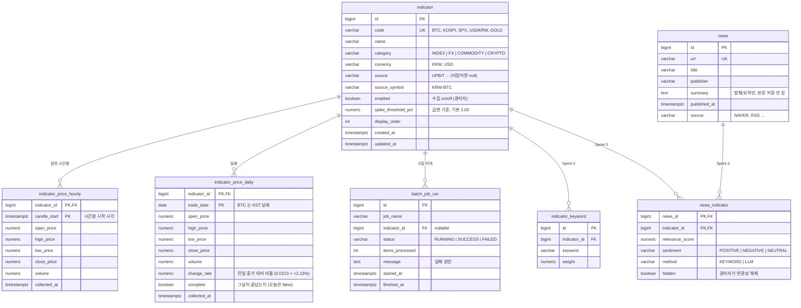

# ERD

스키마의 기준은 Flyway 마이그레이션(`backend/src/main/resources/db/migration`)이다. 이 문서는 설계 의도를 설명한다.
시각 컬럼은 모두 `timestamptz`(UTC 저장), 거래일은 `date`(지표별 기준 시간대의 날짜)다.

## 설계 메모

- **시간봉을 따로 저장하는 이유**: 업비트 일봉은 UTC 00시(KST 09시) 경계라서, KST 00시 기준 일봉은 60분봉을 집계해 만든다(`docs/poc/data-sources.md`). 원천 시간봉을 남겨 두면 집계 로직을 고쳤을 때 외부 API를 다시 부르지 않고 재계산할 수 있고, 나중에 BTC 시간 단위 차트에도 쓸 수 있다. 3년치 약 26,300행이라 부담이 작다.
- **일봉 `complete`**: 오늘(KST) 일봉은 매시간 갱신되는 미완성 값이다. 급변일 판정과 뉴스 연관성 계산은 `complete = true` 인 날만 대상으로 한다.
- **`change_rate`는 비율**로 저장한다(업비트 응답과 같은 형식). 급변 판정은 `abs(change_rate) * 100 >= spike_threshold_pct`.
- **키 설계**: 가격 테이블은 `(indicator_id, 시각/날짜)` 복합 PK라 같은 데이터를 다시 받아도 `ON CONFLICT DO UPDATE`로 덮어쓴다(수집 재실행이 안전함).
- 뉴스 관련 테이블(`news`, `news_indicator`, `indicator_keyword`)은 Sprint 3 에서 마이그레이션을 추가한다.
